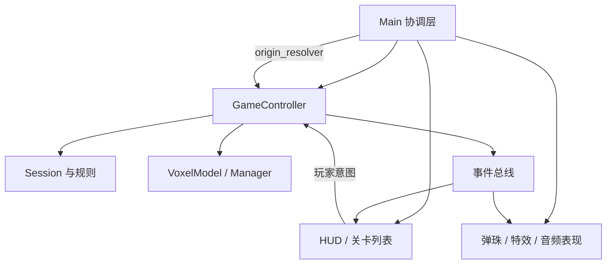

# 第 5 章：主场景不是全部节点的静态清单

[上一章](04-voxel-rendering.md) · [总目录](README.md) · [下一章](06-gameplay-transactions.md)

## 本章目标

从展示一只青蛙过渡到启动完整游戏。你将逐个认识主场景里的固定节点，跟踪运行时创建的控制器、UI 和表现对象，理解关卡切换为什么必须有严格的清理顺序。完成后，你能根据一个异常判断应先看 main、controller、service 还是 presenter，而不是把所有修复塞进主脚本。

## 概念讲解：组合与职责

组合（Composition）的核心是对象各自承担有限责任，再通过明确接口连接。它不等于“多拆几个文件”。如果每个文件都随意修改其他对象状态，拆文件只会让跳转更费力。当前 main 协调场景与生命周期，controller 驱动局内状态，服务处理事务，presenter 把状态变成图像与声音。这个边界应从调用方向理解，而不是只按文件夹名字记忆。

例如炮口屏幕位置只有 HUD 知道，但控制器需要一个发射原点才能选靶。若控制器直接在场景树中搜索某个按钮，测试就必须搭整套 UI。项目改为注入 origin_resolver：表现层提供“给定槽位，算出原点”的函数，控制器只消费返回值。测试可以注入稳定的原点，实际游戏使用可见炮口。依赖注入在这里解决的是可验证性，不是为了套设计模式名词。

相机和光源属于场景表现，体素状态不应因相机隐藏而停止存在。反过来，渲染模型暂时不可见也不能自动判胜利。把“场景存在”“会话有效”“游戏正在推进”分开，才有办法处理返回列表、暂停、结算和后台恢复。这个区别在 headless 测试中特别明显：没有可见窗口，业务仍然可以通过手动步进运转。

## 动手步骤：由静态树追踪到运行树

先在编辑器打开练习副本的完整项目，不是 sandbox。命令是：

```bash
"$GODOT_BIN" --editor --path "$TUTORIAL_LAB"
```

打开 [scenes/main/main.tscn:1](/Users/zhaojian/code/godot-voxel-block-smash/docs/tutorial/source-baseline/scenes/main/main.tscn.txt:1)，按树逐层检查：

```text
Main : Node3D                 ← main.gd
├── Camera3D                 ← 当前三维相机
├── DirectionalLight3D       ← 定向光，当前关闭阴影
└── WorldEnvironment         ← 背景与环境光资源
```

Main 本身不画青蛙，它提供装配位置。Camera3D 有一个略俯视的变换；DirectionalLight3D 提供方向性的明暗；WorldEnvironment 使用暗色背景和环境光，让背光面仍能读出轮廓。初学者可以先禁用方向光再恢复，观察体素体积感变化，但不要把这个实验的视觉结果直接当性能优化结论。

如果你在 sandbox 重建静态主场景，可以逐节点照着类型添加，再通过检查器设置属性。复杂 Transform3D 的九个基向量分量不必手抄，用编辑器的旋转和位置理解效果后，再对照 tscn 序列化值。文本文件是保存形式，不是要求人类直接编辑矩阵的唯一入口。

运行完整项目并切换到 Remote 树。[scripts/app/main.gd:30](/Users/zhaojian/code/godot-voxel-block-smash/docs/tutorial/source-baseline/scripts/app/main.gd.txt:30) 创建 GameController、HitEffects、MarblePresenter、AudioPresenter，再建立 CanvasLayer 和 HUD、关卡列表、性能监视器及回放器。注意 CanvasLayer 让二维 UI 独立于三维相机视角；否则你转动模型时，按钮可能也像场景物体一样被投影。

下面是角色关系图，名称描述职责，不保证所有动态节点在 Remote 中都被显式命名成相同字符串：



选择关卡后，沿 [scripts/app/main.gd:70](/Users/zhaojian/code/godot-voxel-block-smash/docs/tutorial/source-baseline/scripts/app/main.gd.txt:70) 看顺序。先关闭输入，清理旧会话，再启动新关卡；成功后注入原点解析器、适配相机、绑定 HUD 和音效等订阅，最后开启输入。这个“先准备、后对外可用”的顺序避免玩家在半初始化时点击到空 session。它与普通软件中“先构造有效对象，再暴露引用”是同一个原则。

体素子场景 [scenes/voxel/voxel_model.tscn:5](/Users/zhaojian/code/godot-voxel-block-smash/docs/tutorial/source-baseline/scenes/voxel/voxel_model.tscn.txt:5) 很小，只挂 ModelNode 脚本。当前实际装配要以 controller 的 new/add_child 路径为准，不能因为文件存在就声称 main.tscn 静态嵌入了该 PackedScene。场景文件可以表达可复用组件，脚本实例化也能构建同类节点；两种方式不能在教程里含糊混写。

相机适配入口 [scripts/app/main.gd:257](/Users/zhaojian/code/godot-voxel-block-smash/docs/tutorial/source-baseline/scripts/app/main.gd.txt:257) 结合模型包围信息和视口，把模型放在内容区域。为什么不固定相机 Z 为一个“看起来不错”的数字？因为同样 4105 块可以组成胖青蛙或细长模型，块数不等于外接尺寸。通过包围尺寸拟合能更稳定地保留 UI 空间，但不同造型仍需实际观察构图。

> 📷 截图：静态 Main 树与运行时 Remote 树并排；建议在练习副本启动后截图，标明 VoxelMultiMesh、CanvasLayer 和动态控制器位置。

### 延伸练习：为每个对象写生命周期表

给Main、Controller、Session、HUD和VoxelModel各写创建时机、清理时机、能否跨关卡共享。Main与HUD可以在列表和游戏之间持续存在，Session代表一局，模型数据和节点按当前关卡装配。这里不要只根据类名推断，要沿new、add_child、clear和free的实际调用核实。生命周期表能让重复音效、旧事件和内存增长的排查有明确方向。

然后做一次依赖倒置练习：如果没有HUD，控制器还需要什么才能发射？答案不是整套按钮，而是一个返回炮口原点的函数。这个最小接口让headless测试成为可能。类似地，音效只需接收事件和颜色等反馈信息，不应反过来决定是否扣弹。用“去掉这个表现对象，逻辑是否还能验证”检查设计，比机械地给所有类加接口更有针对性。

最后思考失败启动。模型读失败时，哪些对象已经创建，哪些尚未绑定？列表是否重新显示？输入是否仍被关闭？如果这些状态没人负责，用户会看到没有按钮可点的空窗口。初始化失败也是生命周期的一部分，需要像正常通关一样有明确出口，而不是只向控制台打印错误后返回。

## 踩坑记录：清理顺序也是功能

当前 [scripts/app/main.gd:124](/Users/zhaojian/code/godot-voxel-block-smash/docs/tutorial/source-baseline/scripts/app/main.gd.txt:124) 先取消输入归属和旋转 hold，再按需要保存，停止调度，清理 HUD 过渡、特效、弹珠、声音与记录器。想象反过来先删 HUD，再让旧 Tween 回调更新控件；或者先开始新关卡，再收到上一局命中事件。很多“偶发闪一下”实际上来自生命周期顺序，而不是动画曲线不够平滑。

事件总线携带关卡和会话代际，用来拒绝旧会话事件。它解决的是身份边界，不代表任何事件都自动安全。接收者仍要判断票据是否已结算、目标是否存活。代际保护与幂等结算互补：前者隔离“上一局”，后者隔离“同一局重复消息”。只实现其中一个都不够。

主脚本也不是理想化模板。当前存档备份失败时仍可能继续新局，后续保存存在覆盖原档的风险；仅“打印备份失败”不等于完成保护。本教程在存档章会继续说明这个边界。阅读真实项目时应学会区分已有改善和仍需完善的路径，而不是把成熟函数名当作正确性证明。

还有一个常见误读是以为表现层事件能直接成为业务事实。音效播放成功不说明碰撞成功，粒子出现也不说明数据已删。正确方向应是控制器确认事实后发通知，表现层据此播放。这样即使无音频设备或窗口隐藏，业务也能继续正确结算。

## 验证方法

启动后检查关卡列表能进入游戏，模型和五槽布局出现。返回列表再进入，确认没有叠加第二只模型，没有同一次发射响两声。这个简短观察不能证明无泄漏，但能够快速暴露重复装配。

进一步查阅 [tools/lifecycle_check.gd:1](/Users/zhaojian/code/godot-voxel-block-smash/docs/tutorial/source-baseline/tools/lifecycle_check.gd.txt:1) 的循环测试。它有隔离目录和重复进入、返回的检查。先读清楚再按第 12 章运行；本章不要求为了学习节点树执行完整长测。你应能够从树中找到谁负责资源释放，并解释为什么 queue_free 不是所有 RefCounted 服务都需要调用的方法。

本章完成后应该能看到完整游戏界面，并画出“按钮意图→控制器→状态改变→事件→表现”的路径。此时仍不必逐行读完 main；知道关键入口在哪里，比把几百行代码逐字背下来更有用。

## 小结

场景树决定对象如何进入引擎，服务边界决定业务如何保持可测，生命周期决定旧对象何时停止影响新对象。下一章把一个点击拆成队列、槽位、票据和子弹之间的事务，理解完整游戏为何不能只写“弹药减一”。

[上一章](04-voxel-rendering.md) · [下一章](06-gameplay-transactions.md)
