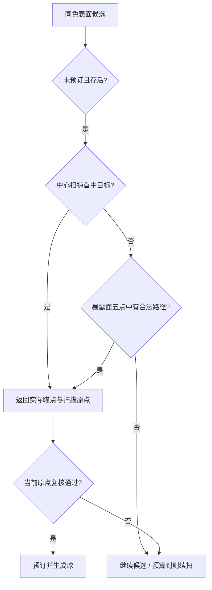

# 第 8 章：选靶不是找颜色，而是证明路径可达

[上一章](07-local-ballistics.md) · [总目录](README.md) · [下一章](09-input-and-rotation.md)

## 本章目标

理解“明明看见同色块，炮台为什么不开火”，并读懂多点命中、分片扫描、负缓存和时钟域。完成后，你能区分没有目标、扫描未结束、目标被预订、原点变化复核失败等状态，避免用盲目提高发射频率掩盖真正问题。

## 概念讲解：可见与可达有不同观察点

玩家通过相机看模型，子弹从炮口出发。相机可见的一小块绿色，可能在炮口方向被黄色挡住。因此“屏幕看见同色就必须打中”不是严格可实现的遮挡规则。体验优化应消除算法过严导致的漏选，而不是删除真实遮挡。当前目标选择要求候选同色、存活、未预订，并且完整扫掠的首个命中就是目标。

旧中心点方案只尝试方块中心。若中心被邻块挡住、边缘有足够宽的可达部分，就会拒绝一个实际上能打到的方块。新方案先试中心，再对朝向炮口的暴露面采样面中心和四个内缩角。每点都使用实际球半径和同一求解器。它增加可找到路径的机会，但有限采样仍不等于穷尽所有连续路径，不能宣称任何可达小缝都一定能找出。

成功结果因此不应只有 voxel_id。[scripts/gameplay/target_selector.gd:335](/Users/zhaojian/code/godot-voxel-block-smash/docs/tutorial/source-baseline/scripts/gameplay/target_selector.gd.txt:335) 和 find_target 返回 aim_grid_point、face_id、origin_used、geometry_version 等信息。aim_grid_point 是本次证明过的路径终点；如果发射时又改回中心，刚才的证明就作废。结果结构携带的不只是“选中了谁”，还包含“怎样选中的”。

## 动手步骤：从便宜过滤到昂贵确认

先读前沿集合。内部被完全包住的块暂时不可被第一命中，扫描它们浪费时间。selector 按色维护表面候选，并记录六个暴露面位掩码。删除一个方块后只需关注它的邻居哪些面新暴露，而不必立即全模型重建。候选集合允许惰性清理已删项，但必须去重，否则多次暴露会让数组无限膨胀。

然后看热点路径：尝试上次目标和六邻同色块。连续消除经常沿局部表面推进，热点命中能跳过全扫描。缓存只是候选提示，肯定结果仍做几何确认，不能直接拿“上次这里可达”当作现在可以扣弹的凭据。模型旋转、目标预订和方块删除都会改变可用条件。

全扫描使用距离分桶和断点。扫描状态保存起始桶 start、已经完成的桶数 k、当前桶内下一索引 ii。只有整桶扫完才推进 k；否则下次恢复会跳过当前桶剩余候选。这个 bug 不一定导致异常，只会让某些块“永远轮不到”，所以必须用小预算把一次查询拆成很多片，与不限预算结果对照。

[scripts/gameplay/target_selector.gd:43](/Users/zhaojian/code/godot-voxel-block-smash/docs/tutorial/source-baseline/scripts/gameplay/target_selector.gd.txt:43) 定义单次 3000 微秒；旁边 step_budget_us 为每步共享 6000 微秒。二者有不同作用：一次查询不能独占太久，多个炮台合起来也不能无限叠加。预算检查放在候选循环顶部，覆盖提前 continue 的路径。返回 scan_pending 表示需要下一步继续，不是完整搜索失败，调度器应立即续扫而非等待正常射击冷却。

这里要对“预算”保持精确。当前计时片段从部分几何准备之后开始，热点确认和单个候选内多点扫掠并非随时可中断；共享余量按片段结算。因此 3ms、6ms 是扫描调度目标，不是整个 find_target 或整帧耗时的硬上界。阅读参数名不能代替检查计时器放在哪里。若 profiler 显示首扫仍超时，先看未计入区域和单候选最坏成本。

多点算法见 [scripts/gameplay/target_selector.gd:354](/Users/zhaojian/code/godot-voxel-block-smash/docs/tutorial/source-baseline/scripts/gameplay/target_selector.gd.txt:354)。候选面的法向朝向原点才尝试；面内坐标取 0.2、0.5、0.8，但跳过边中点，保留五点。法向向块内偏移 0.06，避免终点恰好落在边界时格归属含糊。先做 DDA 遮挡预过滤，再做实际半径 sweep，最终首命中 ID 一致才接受。过滤层与精确层要使用兼容的格约定。

可以画出如下决策流程，每条失败出口都不扣弹：



跨片扫描期间原点会随旋转变化。项目把一轮扫描固定在 origin0，避免各片分别用不同原点后得出没有逻辑依据的“整体无解”。成功后控制器用当前原点对同一瞄点复核，失败返回 revalidate_failed，下个物理步继续查找。历史 UX 每局有十余次复核失败，这代表保护生效，不能为了让失败计数归零把复核删掉。

### 延伸练习：为缓存写一份失效清单

不用先写代码，列出删除方块、旋转模型、移动炮口、释放预订、切换关卡五类变化。对每类变化分别问：候选列表是否变、几何可达性是否变、可用性是否变、旧缓存身份是否仍有效。这样会发现一个统一版本号未必能准确表达全部变化。预订释放没有改变几何，却能让暂时不可用的目标重新可用，所以扫描跳过预订时不应随意缓存完整否定。

再比较响应和负载。没有负缓存时每次都重扫，响应机会多但可能让帧率下降；缓存太久时帧率很好却炮台发呆。合理目标是有界延迟和可控计算，而非缓存命中率越高越好。记录从目标变可达到实际发射的延迟分布，比只记录查询次数更贴近用户问题。这个延迟还包含调度冷却，不能全部归因于TTL。

最后用狭窄可见边缘理解有限采样的边界。五个面点全失败并不构成连续几何空间无解的严格证明，但它在当前成本预算内提供更好的体验。若未来要求更高覆盖率，可以比较自适应采样或目标投影面积排序；每增加一种策略，都需测最坏耗时与真实首命中，不能只统计找到目标的次数。

## 踩坑记录：缓存存的是有条件的结论

负缓存保存“某条件下没有可达目标”。当前 key 包含颜色和量化原点，gen 表示删除几何代数；若 gen 一致且 tver 相同，可继续使用；若姿态变化，则只允许在 0～0.1 秒的 TTL 内短暂退避。不是简单要求 gen、tver、TTL 三项同时成立。这个“或”的细节决定持续旋转时缓存是否完全失效。

粗原点 key 把多个真实位置合并，缓存可能短暂推迟发现新路径。即使代码认为姿态未变，外部若仅改变相机或炮口而未更新几何版本，也要重新审视长期负缓存的前提。当前正式路径有特定布局和旋转更新方式；将 selector 复制到另一款游戏时，必须把所有影响可达性的输入纳入失效策略。

时钟域 bug 是最值得复盘的真实案例。旧条目用启动后的墙钟秒写入，例如 0.537；调用方随后注入从关卡开始累计的模拟秒，例如 0.016。两者相减得到负 age。若只判断 `age <= TTL`，负数总是满足上限，缓存会异常持续服务。修复统一使用模拟时钟，并对负 age 做保护，见 [scripts/gameplay/target_selector.gd:77](/Users/zhaojian/code/godot-voxel-block-smash/docs/tutorial/source-baseline/scripts/gameplay/target_selector.gd.txt:77) 与 [docs/dev-step-log.md:512](/Users/zhaojian/code/godot-voxel-block-smash/docs/tutorial/source-baseline/docs/dev-step-log.md.txt:512)。

这不是“计时函数精度太低”，而是两个时间原点不同。暂停时模拟时间不前进，性能计时仍需要单调现实时间；两种时钟都合理，不能混减。headless 快进几百个物理步可能只过几毫秒墙钟，测试最容易放大这种差异。学习到这里，你应给变量名加上 sim、wall 或 usec，而不是统一叫 time。

预算漏检也有同样的隐蔽性。若只在昂贵 sweep 后检查时间，大量“不可用”“背向”候选走 continue，就能绕过检查。单个过滤很便宜不代表几千次过滤免费。移到循环顶部解决路径覆盖，但仍需测量函数之外的分桶构建成本。这说明性能修复既有控制流正确性，也有测量范围正确性。

## 验证方法

```bash
"$GODOT_BIN" --headless --path "$TUTORIAL_LAB" -s tests/unit/test_selector_scan.gd
"$GODOT_BIN" --headless --path "$TUTORIAL_LAB" -s tests/integration/test_targeting_points.gd
```

第一套验证很小预算下续扫不会遗漏候选；第二套包含中心被挡但面点可达、完全被挡、缓存期限和原点变化。历史 UX09 的目标点 `(5.8,8.06,5.2)` 不等于中心，真实飞行命中目标且挡块仍活着，这比只断言 selector 返回 ok 更强。UX11 记录约 7 帧内开火，是特定夹具结果，不是所有关卡的通用响应保证。

本章完成后你应该能把“炮台不发射”分解成可观察的原因，并能说明为何 scan_pending 数量很高未必意味着低效。最终判断还要看真正命中吞吐、帧耗时和完成时间，而不是优化某一个计数让报告好看。

## 小结

目标选择把几何正确性、调度公平和体验响应连在一起。缓存必须注明前提，预算必须覆盖路径，成功结果必须携带可以再次验证的瞄点。下一章处理这些计算所依赖的模型姿态如何由玩家与自动旋转共同驱动。

[上一章](07-local-ballistics.md) · [下一章](09-input-and-rotation.md)
