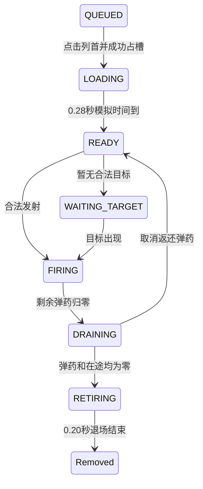

# 第 10 章：动画不是装饰，而是状态的一部分

[上一章](09-input-and-rotation.md) · [总目录](README.md) · [下一章](11-performance-engineering.md)

## 本章目标

解决两种具体体验：炮台点击后像突然跳到槽位，以及弹药耗尽后瞬间消失。我们不会只调 Tween 曲线，而是建立 LOADING、DRAINING、RETIRING 的业务语义，让视觉过渡与射击资格同步。完成后你能解释上位期间暂停、最后一发取消、退场期间结算等异常时序如何处理。

## 概念讲解：所有权、行动资格与画面分开

炮台从队列移动到槽位时，所有权必须立即确定，否则连续点击可能把同一门炮上位两次。但立即属于槽位不代表立刻能够射击，也不代表槽位必须立即显示完整图像。三件事可以分别是：数据已经占槽；状态仍在 LOADING；过渡层负责绘制移动中的完整炮台。

旧上位实现先刷新槽位，再飞一个只含炮身的半透明贴图，玩家看见目标处已经有炮，移动影像只像附加特效。根因是“从哪里到哪里”的视觉身份不连续。新方案用完整 CannonView 携带炮身、炮管、颜色和弹药数字，在独立过渡层飞行；目标槽显示占位而不重复显示完整炮台。

退场反过来：弹药为零只说明不能再开新火，不说明最后几颗球已经结束。DRAINING 等待所有在途票据结算；确认 ammo=0 且 in_flight=0，再进入 RETIRING，保留槽位直到缩小淡出完成。视觉退场不再与新炮上位抢同一个位置。状态机把“以后何时释放资源”变成明确规则。

## 动手步骤：先画状态图再读动画



图为了讲核心链路省略 RETURN_PENDING 等支路，完整状态常量在 [scripts/gameplay/cannon_queue_service.gd:17](/Users/zhaojian/code/godot-voxel-block-smash/docs/tutorial/source-baseline/scripts/gameplay/cannon_queue_service.gd.txt:17)。状态图不是代码自动生成的形式化规格，阅读时必须回到真实条件，尤其不能凭字符串 DRAINING 就判断“该删除了”。

[scripts/app/game_controller.gd:232](/Users/zhaojian/code/godot-voxel-block-smash/docs/tutorial/source-baseline/scripts/app/game_controller.gd.txt:232) 定义 0.28 秒，RETIRE_SEC 为 0.20 秒。控制器通过 `_tick_transitions(dt)` 推进剩余时间，表现层读取 loading_progress 与 retire_progress。业务完成不依赖 Tween finished 回调，因为暂停、窗口隐藏、切场景或测试无界面都可能使视觉路径被打断。模拟时钟到点，业务仍能得到明确状态。

阅读 [scripts/presentation/hud_presenter.gd:699](/Users/zhaojian/code/godot-voxel-block-smash/docs/tutorial/source-baseline/scripts/presentation/hud_presenter.gd.txt:699)：取得源控件矩形应早于队列变更，否则 refresh 后“来源位置”可能已经是下一门炮。调用 place_front 成功后建立过渡视图。[scripts/presentation/hud_presenter.gd:726](/Users/zhaojian/code/godot-voxel-block-smash/docs/tutorial/source-baseline/scripts/presentation/hud_presenter.gd.txt:726) 保存来源、目标槽和炮台 ID，随当前进度更新；它不是在每次 HUD 刷新时重新创建 Tween。

把动画分成三个可检查时段：起步时源处只有一门完整炮；中途过渡层中的炮移动、目标槽不提前冒出副本；落位后过渡对象销毁、槽位视图接管。动画曲线可以以后调，但这三个身份连续条件先成立。弹药数字也属于视觉身份，若炮身飞走数字留原地，仍然会显得卡顿。

同一列短暂禁止重复上位，可以防止源视图正在补位时再次被取作起点；其他列不必全局锁死。跨列并行动画按 turret_id 管理，不应只用一个“当前上位 Tween”变量。重开时清理整套过渡，避免旧完成回调去操纵新局恰好相同槽号的炮台。会话代际与视觉对象生命周期共同决定安全性。

退场入口 [scripts/app/game_controller.gd:299](/Users/zhaojian/code/godot-voxel-block-smash/docs/tutorial/source-baseline/scripts/app/game_controller.gd.txt:299) 发出包含颜色和弹量的快照。表现层可收缩到约 0.15 并淡出；控制器保留原槽直到剩余时间到点，再删除炮台和释放槽。若最后一块已消除，终局逻辑会停止普通玩法推进，但 step 仍需推进剩余退场时钟。否则最后一门炮永远卡在半透明状态，胜利遮罩也可能一直等不到。

取回支路是检验设计是否完整的好例子。玩家在最后几发飞行时点取回，炮台变 RETURN_PENDING，停止新发射但等待结算。若全部成功后弹药为零，进入退场；若有取消返还，带剩余弹药回来源列。以 ammo/in_flight 数值决定收尾，不能只判断原状态是否 DRAINING，因为它已经被取回状态覆盖了。

保存时也要处理过渡。当前实现把 LOADING 归一成可恢复的 READY，避免重启后还需要重播来源位置已经不存在的动画；RETIRING 可以在保存归一流程中完成收尾。原则是恢复后保留资源守恒和唯一归属，而不是逐帧复刻关掉窗口前的一张图。若将来要求精确恢复动画，需要额外保存时长和布局语义，而非只多存一个字符串。

### 延伸练习：用时间轴找动画竞态

画一条从0到0.5秒的轴，标出点击、队列出列、槽位占用、首次可射击和过渡视图销毁。再在0.1秒插入暂停，在0.15秒插入重开。每个对象应有唯一答案：继续、冻结、取消或重建。若某个回调无法判断自己属于哪一局，就说明需要代际标识或清理约束，而不是再加一个随机延迟。

退场也画一次：最后一发生成、先到的一颗命中、最后一颗取消、退款恢复。此时不应进入RETIRING。换成最后一颗也命中，才进入退场。两个序列只差一个结算结果，画面行为却不同，正适合做成成对测试。它能发现那些只以ammo为零判断退场的实现。

表现层还要考虑低帧率。0.20秒动画在10FPS下只有约两帧，即使曲线正确也可能看起来突然。不能把所有突兀都归因为Tween写错；应先确认帧时间，再检查对象是否提前隐藏，最后调时长与曲线。这样能避免为了补偿性能问题把动画无限拉长，反过来拖慢整局节奏。

## 踩坑记录：一个零弹数字有多种含义

截图中显示 0 不一定是漏删炮台，它可能仍在 DRAINING 等最后几发。测试应区分“短暂可见的结算中”和“永远不释放”。若为了让画面没有 0 立刻隐藏炮台，会把真正的在途语义藏起来，退款时还可能突然重新出现。与其抹掉过渡，不如让过渡短、连续、可解释。

历史方案提出“终局时间包含最终动画”，当前 replay 的 effective_clock 在 outcome 不再 RUNNING 后停止，而控制器仍推进 RETIRING。回放报告记录的是逻辑胜利时刻，不足以精确证明最终遮罩出现的时刻。13 局最慢不到 191 秒，离 300 秒很远，但教程不能因此声称计时口径完全相同。严格验收需另加 final_visual_complete 时间或录像测量。

同样，保存备份返回值已被检查，不等于坏档保护彻底闭环。当前 main 在备份失败后仍可能启动新局，后续保存有覆盖风险；教程应建议维护者为这一分支加“禁止覆盖原档”的明确门禁和端到端用例。这里记录剩余问题，不修改当前游戏。真实项目教学的价值也包括识别一个修复还没覆盖哪些路径。

最后，测试进度不是动画观感。逻辑断言能证明 0.28 秒前零开火、到点后 READY，却无法证明飞行路径不被裁切、数字和炮身没有错位。因此本章的验收必须拆成逻辑和录像两列。UX 报告保留“上位中点暂停”的实机时序 NOT_RUN，不能在教程中补写成已经实测。

## 验证方法

```bash
"$GODOT_BIN" --headless --path "$TUTORIAL_LAB" -s tests/integration/test_loading_retire.gd
"$GODOT_BIN" --headless --path "$TUTORIAL_LAB" -s tests/unit/test_presentation.gd
```

第一套的关键序列是上位后推进约 0.167 秒，断言没有开火；再推进到约 0.33 秒，确认离开 LOADING。随后覆盖保存归一、最后一发结算、零弹取回和终局退场。读者可以改用更细步长观察阈值附近，但不要把浮点精确相等当作测试目标。

人工验证各列上位，观察完整炮的移动；耗尽时确认先结算、再收缩、后补位。接着在移动中暂停、恢复、重开，检查残影和重复炮台。截取关键帧要包含源、路上和目标三个阶段，不要仅截最终槽位来证明动画存在。

本章完成后你应该拥有一个逻辑上可完整通关、视觉上有明确上位和退场的游戏副本。真实完整局可按第 13 章回放验证，当前章节不要求你手动操作数千次。切记“可通关的代码路径”和“已在当前设备完整通关”仍然是两种结论。

## 小结

好的动画要有可信的业务时间轴。把所有权、射击资格和视觉表示分开，再由统一状态连接它们，就能让卡顿感、退款和场景切换等看似不同的问题得到一致处理。

[上一章](09-input-and-rotation.md) · [下一章](11-performance-engineering.md)
